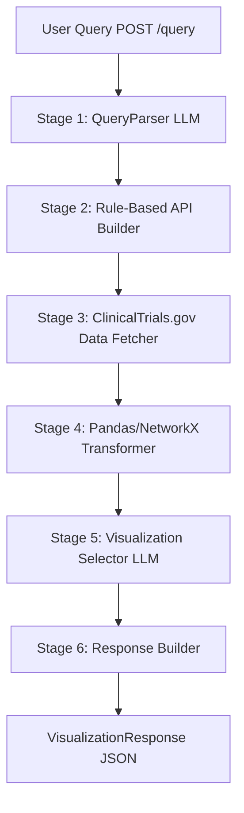

# Problem

Traditional RAG (Retrieval-Augmented Generation) systems use external data sources to reduce hallucinations by grounding responses in retrieved information. However, when working with OpenAPI-based data retrieval systems, several forms of hallucinations can still occur.

### Examples

- Generating API parameters that do not actually exist
- Referencing fields that are not present in API responses
- Fabricating statistical or aggregated results (the most dangerous case)
- Producing inconsistent answers for identical queries

This becomes particularly critical when working with medical datasets such as ClinicalTrials.gov. Incorrect statistics or misleading results can directly influence decision-making processes, making a hallucination rate as close to **0%** as possible a primary design goal

# Architecture

This pipeline is designed as a **deterministic analytics pipeline**. LLMs are used only for interpretation and visualization selection, never for numerical computation.



### Terminology

- Query: A natural language question submitted by the user

### Query Interpretation and Entity Extraction (LLM)

`query_parser.py` -> QueryParser.parse()

The LLM generates a structured ParsedQuery object

If users explicitly specify filters such as drug names or year ranges, override any entities extracted by the LLM

| Field                    | Role                                                                   | Example                                                                                                               |
| ------------------------ | ---------------------------------------------------------------------- | --------------------------------------------------------------------------------------------------------------------- |
| **intent**               | Defines one of the supported analysis types                            | `TREND_OVER_TIME`, `DISTRIBUTION`, `COMPARISON`, `CORRELATION`, `RELATIONSHIP_NETWORK`, `RANKING`, `OUTLIER_ANALYSIS` |
| **entities**             | Parsed filters used for ClinicalTrials.gov API searches                | Drug, Condition, Phase, Sponsor, Year Range, Comparison Pairs                                                         |
| **query_interpretation** | Human-readable summary used as chart titles or contextual descriptions | "Trend analysis of enrollment counts in colorectal cancer trials over time"                                           |

### 2. Search Query Construction

`api_builder.py` $\rightarrow$ `build_ct_params()`

Parsed entities are mapped to ClinicalTrials.gov v2 API parameters using YAML registries such as `query_registry.yaml` and `field_registry.yaml`

For example: 
```
drug_name -> query.intr
condition -> query.cond
```

- If no structured entities can be extracted, the original user query is used as a keyword search

- If no matching information exists, the system explicitly returns that no data was found

### 3. Data Retrieval (HTTP + Cache)

`data_fetcher.py` and `clients/clinicaltrials.py`

The system continuously paginates through the ClinicalTrials.gov API until it reaches the maximum result count (default: 500)

1 hour in-memory TTL cache prevents redundant API requests by caching responses based on query parameters and result limits

A `background field discovery` scans newly observed JSON paths and registers them as candidate fields for future registry expansion. This allows the system to adapt as new data fields become available in the ClinicalTrials.gov dataset

### 4. Deterministic Data Augmentation (No LLM Involved)

`transformer.py`, `normalizers.py` and `transforms/*`

Processing Flow
1. normalize_studies()
    Converts nested ClinicalTrials.gov JSON into a flattened DataFrame containing fields such as NCT ID, phase, enrollment count, dates, and sponsors.
2. Applies filters based on:
    Phase, Year ranges, Country, Parsed entities
3. `Transformer.transform()` dispatches execution based on `QueryIntent`

| QueryIntent              | Description                                                   | Transform Function                                                      | Visualization Examples             |
| ------------------------ | ------------------------------------------------------------- | ----------------------------------------------------------------------- | ---------------------------------- |
| **TREND_OVER_TIME**      | Trial count trends over time                                  | `transform_trend()`                                                     | Line Chart, Stacked Area Chart     |
| **DISTRIBUTION**         | Distribution across phases or statuses                        | `transform_distribution()`                                              | Bar Chart, Pie Chart               |
| **COMPARISON**           | Compare multiple drugs or conditions                          | `transform_comparison()` or entity-specific fetches followed by merging | Grouped Bar Chart, Radar Chart     |
| **CORRELATION**          | Relationship between two variables (e.g., enrollment vs year) | `transform_correlation()`                                               | Scatter Plot, Bubble Chart         |
| **RELATIONSHIP_NETWORK** | Sponsor, intervention, or study relationship networks         | `transform_network()` (NetworkX)                                        | Network Graph                      |
| **RANKING**              | Top sponsors, diseases, or interventions                      | `transform_ranking()`                                                   | Horizontal Bar Chart               |
| **OUTLIER_ANALYSIS**     | Detect studies with unusually high enrollment                 | `transform_outlier_analysis()` (z-score based)                          | Box Plot, Highlighted Scatter Plot |

All counts, aggregations, and statistical calculations are performed using `Pandas and NetworkX` rather than LLMs. This completely eliminates the possibility of hallucinated numerical results

The output consists of:

- A transformed DataFrame or network structure
- A citation_map linking results back to original NCT IDs for traceability

### 5. Visualization Schema Generation (LLM, Schema Only)

`viz_selector.py` $\rightarrow$ `VizSelector.select()`

The LLM receives:

- Column names
- Data types
- A sample row
- Total row count
- QueryIntent
- Query interpretation

It returns a VizSpecOutput containing:

- Chart type
- Chart title
- Vega-Lite style encoding schema

Importantly, actual data values are never exposed to the model. Prompt constraints ensure the model only generates visualization specifications

### 6. Final Response Assembly (Rule-Based)

`response_builder.py` $\rightarrow$ `ResponseBuilder.build()`

The response builder combines:

- Actual transformed data from Stage 4
- Visualization schema from Stage 5
- Citation metadata derived from NCT IDs

The final result is returned to the frontend as a structured `VisualizationResponse` JSON object

### Retrospective

1. In pharmaceutical, biomedical, and clinical domains, a single incorrect result can severely damage trust

`ClinicalTrials.gov` contains numerous edge cases such as:

- Missing dates
- Unknown values
- Incomplete metadata
- Hybrid phase classifications

To ensure reliability, real-world API responses containing these edge cases are continuously collected and preserved as test fixture

Every code change is validated through automated pytest suites. By comparing outputs against known-good datasets, even a single extraction or aggregation discrepancy can be detected

The goal is not simply to reduce hallucinations, but to architect a system where numerical hallucinations are structurally impossible